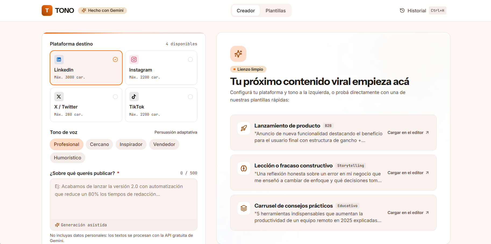

# TONO

Generador de posts para redes sociales con IA (Gemini): elegís la red, el tono y el tema, y obtenés tres variantes listas para publicar.


**Demo:** [juantrezza.github.io/tono-ai](https://juantrezza.github.io/tono-ai/)



## Funcionalidades

- **4 redes sociales:** LinkedIn, Instagram, X y TikTok, cada una con su formato propio.
- **5 tonos:** profesional, cercano, inspirador, vendedor y humorístico.
- **3 variantes por pedido**, cada una con un enfoque distinto:
  1. Directo
  2. Historia personal
  3. Gancho de contrariedad
- **Streaming:** el texto aparece a medida que se genera y se puede detener en cualquier momento.
- **Historial:** las últimas 20 generaciones quedan guardadas en el navegador (`localStorage`).
- **Plantillas:** puntos de partida listos para lanzamientos, casos de estudio, guiones de video y más.
- **Atajos de teclado:** `Ctrl+Enter` para generar y `Ctrl+H` para abrir el historial (`⌘` en Mac).
- **Límite de caracteres por red:** 3000 en LinkedIn, 2200 en Instagram y TikTok, y 280 en X. El servidor también corta el texto si el modelo se pasa del límite.
- **Modo demo:** si no se configura `VITE_API_URL`, la app simula el streaming con textos de ejemplo, sin llamar a ninguna API.

## Arquitectura

```
┌──────────────────────┐   POST /generate    ┌──────────────────────┐   Interactions API   ┌──────────────┐
│  Frontend            │  (JSON con datos)   │  Worker              │   (streaming SSE)    │              │
│  React + Vite        │ ──────────────────► │  Cloudflare Workers  │ ───────────────────► │  Gemini API  │
│  GitHub Pages        │ ◄────────────────── │  valida y arma el    │ ◄─────────────────── │              │
│                      │  texto plano en     │  prompt + API key    │                      │              │
└──────────────────────┘  streaming          └──────────────────────┘                      └──────────────┘
```

**Por qué la API key nunca llega al navegador:** el frontend es un sitio estático y todo lo que se incluye en el build lo puede ver cualquiera desde las herramientas del navegador. Por eso el frontend no habla con Gemini. Le manda al Worker solo los datos del post (red, tono, tema, etc.). El Worker tiene la key guardada como secret de Cloudflare, arma el prompt y llama a Gemini. Al navegador le devuelve solamente el texto generado. La única variable del frontend, `VITE_API_URL`, es la dirección pública del Worker y no es un secreto.

## Seguridad

- **CORS con lista de orígenes:** el Worker solo acepta pedidos de `https://juantrezza.github.io` y `http://localhost:3000`. Cualquier otro origen recibe `403`.
- **Rate limit:** 15 pedidos por minuto por IP con el binding de Rate Limiting de Cloudflare. Si alguien se pasa, recibe `429`.
- **Validación de los datos:**
  - Red y tono tienen que estar en una lista cerrada.
  - La variante tiene que ser 1, 2 o 3.
  - El tema es obligatorio, con un máximo de 500 caracteres.
  - Audiencia y CTA admiten hasta 150 caracteres cada uno.
  - El cuerpo del pedido tiene un tamaño máximo.
  - Cualquier dato inválido devuelve `400`.
- **Prompt armado en el servidor:** el cliente nunca manda instrucciones. El Worker arma el prompt y pasa los datos del usuario como contenido, no como órdenes para el modelo.
- **Key como secret:** `GEMINI_API_KEY` se carga con `wrangler secret put` y no figura en el código ni en el repositorio. En desarrollo local va en `.dev.vars`, que está en el `.gitignore`.
- **Errores sin detalles internos:** si Gemini falla o se queda sin cuota, el cliente recibe un mensaje claro (`502` o `503`). El detalle técnico queda solo en los logs del Worker.
- **Límite de salida:** los tokens de respuesta tienen un máximo por red.

## Stack técnico

### Frontend

- React 19
- TypeScript
- Tailwind CSS
- Vite
- Lucide (íconos)
- GitHub Pages + GitHub Actions para el deploy

### Backend

- Cloudflare Workers (TypeScript)
- Wrangler
- Workers Rate Limiting
- Gemini API, a través de la Interactions API con streaming. El modelo es `gemini-3.8-flash` y se configura en `worker/wrangler.jsonc`.

## Estructura

```
tono-ai/
├── src/                  # Frontend (React)
│   ├── components/
│   ├── constants/
│   ├── services/         # generate.ts: cliente del endpoint /generate
│   ├── types/
│   └── utils/
├── worker/               # Backend (Cloudflare Worker)
│   ├── src/
│   │   ├── index.ts      # Endpoint, CORS, rate limit y streaming
│   │   ├── prompt.ts     # Armado del prompt
│   │   └── validate.ts   # Validación de los datos
│   ├── .dev.vars.example
│   └── wrangler.jsonc
├── docs/
└── .github/workflows/    # Deploy del frontend a GitHub Pages
```

## Cómo correrlo en local

Requisitos: Node.js 20 o superior y una API key de Gemini, que se obtiene en [Google AI Studio](https://aistudio.google.com/apikey).

### 1. Backend (Worker)

```bash
cd worker
npm install
cp .dev.vars.example .dev.vars
```

Editá `worker/.dev.vars` y reemplazá el placeholder por tu key:

```
GEMINI_API_KEY=tu-api-key
```

Después levantá el Worker:

```bash
npx wrangler dev
```

El Worker queda escuchando en `http://localhost:8787`.

### 2. Frontend

En otra terminal, desde la raíz del repo:

```bash
npm install
```

Creá un archivo `.env.local` en la raíz con este contenido:

```
VITE_API_URL=http://localhost:8787
```

Y levantá el frontend:

```bash
npm run dev
```

La app queda en `http://localhost:3000`. Si no creás `.env.local`, la app arranca en modo demo.

> `.dev.vars` y `.env.local` están en el `.gitignore`. No los subas nunca al repositorio.

## Deploy

### Worker (Cloudflare)

```bash
cd worker
npx wrangler login
npx wrangler secret put GEMINI_API_KEY
npx wrangler deploy
```

`wrangler secret put` te pide la key de forma interactiva, así no queda en el historial de la terminal. Al terminar, `wrangler deploy` muestra la URL del Worker, con la forma `https://tono-ai-api.<tu-subdominio>.workers.dev`.

### Frontend (GitHub Pages)

1. En el repositorio de GitHub, entrá a **Settings → Secrets and variables → Actions → Variables** y creá la variable `VITE_API_URL` con la URL del Worker. También podés crearla desde la terminal:

   ```bash
   gh variable set VITE_API_URL --body "https://tono-ai-api.<tu-subdominio>.workers.dev"
   ```

2. El workflow `.github/workflows/deploy.yml` corre en cada push a `main`, usa esa variable en el build y publica el sitio en GitHub Pages. Los cambios que solo tocan `worker/` no disparan el deploy del frontend.

3. Si cambiás la variable y querés publicar de nuevo sin hacer un push, lanzá el workflow a mano:

   ```bash
   gh workflow run deploy.yml
   ```

## Autor

**Juan Moreno Trezza**

- Portfolio: [juantrezza.github.io/porfolio](https://juantrezza.github.io/porfolio)
- GitHub: [@JuanTrezza](https://github.com/JuanTrezza)
